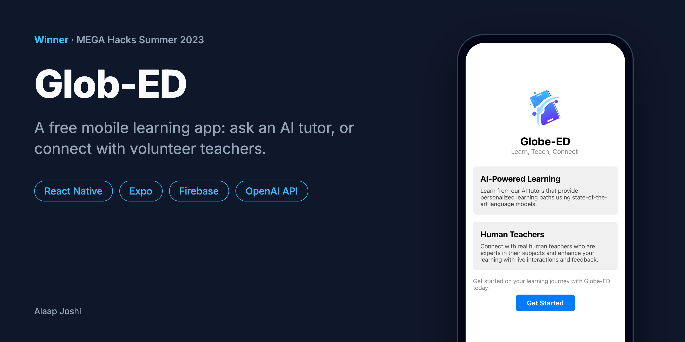
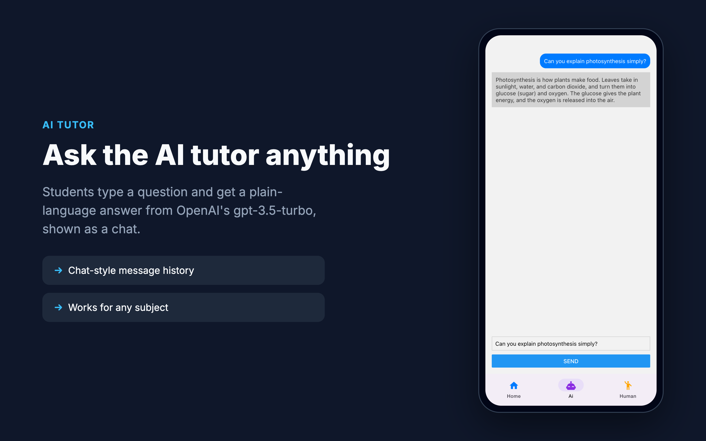
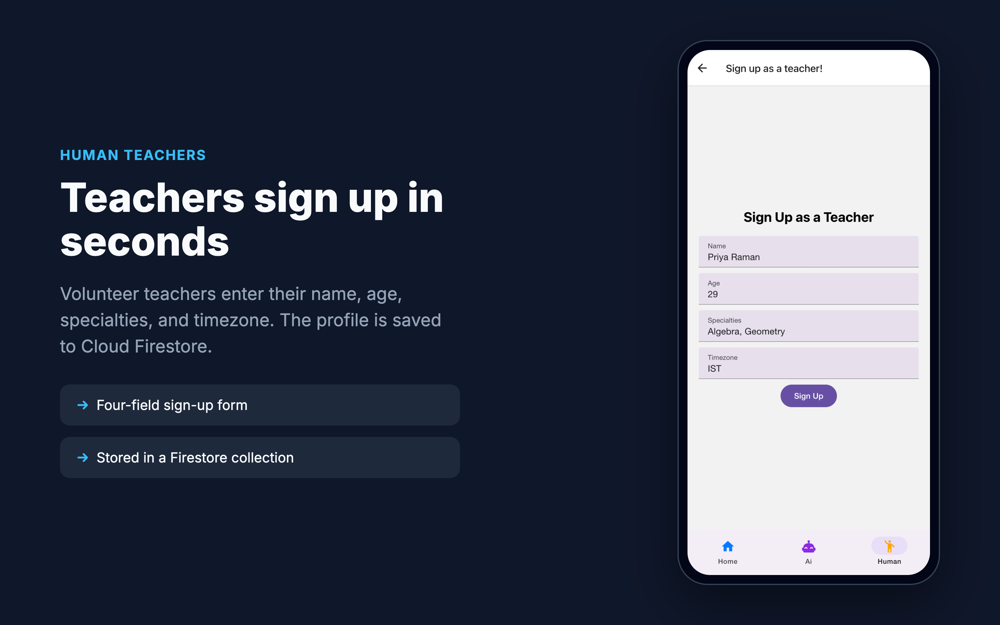
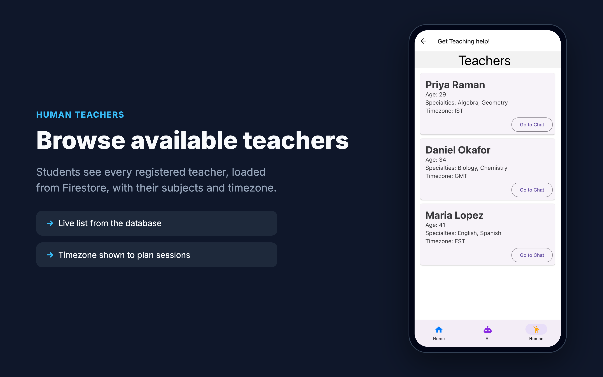
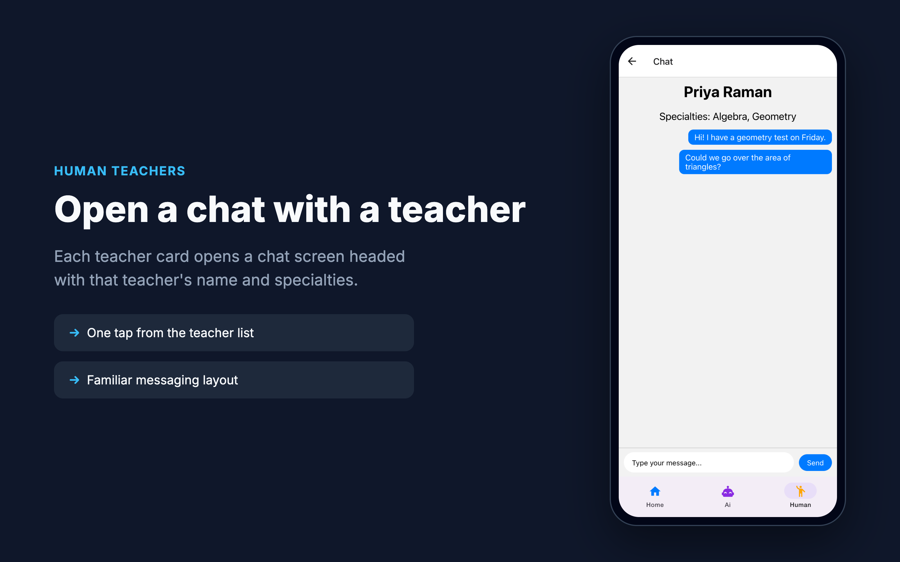

# Glob-ED

> A free mobile learning app for students anywhere: ask an AI tutor, or connect with volunteer human teachers.

   

## About
Many students around the world can't afford tutoring or don't have a teacher nearby. Glob-ED puts two kinds of help in one free app: an AI tutor powered by OpenAI's `gpt-3.5-turbo`, and a directory of volunteer teachers that students can browse and message. Built solo, it won **MEGA Hacks Summer 2023** in the *Multiple Explorations in the Age of Intelligence* track.

## Features
- Answers students' questions in a chat with an AI tutor backed by the OpenAI Chat Completions API.
- Lets volunteer teachers sign up with their name, age, specialties, and timezone, saved to Cloud Firestore.
- Shows students a live list of registered teachers loaded from Firestore.
- Opens a chat screen for any teacher with one tap from the list.
- Runs on iOS, Android, and the web from one React Native codebase using Expo.

## Gallery
<table>
  <tr>
    <td width="50%"> The AI tutor answers a student's question in plain language.</td>
    <td width="50%"> Volunteer teachers sign up with a four-field form.</td>
  </tr>
  <tr>
    <td width="50%"> Students browse registered teachers loaded from Firestore.</td>
    <td width="50%"> Each teacher card opens a chat screen.</td>
  </tr>
</table>

## Tech Stack
| Layer | Technology |
|---|---|
| Frontend | React Native 0.71, Expo SDK 48, React Navigation 6, React Native Paper |
| Backend | OpenAI Chat Completions API (`gpt-3.5-turbo`) via Axios |
| Database | Firebase Cloud Firestore |

## Getting Started

### Prerequisites
- Node.js 18+ and npm
- A Firebase project with Cloud Firestore enabled
- An OpenAI API key
- To run on a phone: Android Studio or Xcode. Current Expo Go releases no longer support SDK 48, so the web build is the quickest way to try it.

### Installation
~~~bash
git clone https://github.com/alaapjoshi/Glob-ED.git
cd Glob-ED
npm install --legacy-peer-deps
npm install --legacy-peer-deps react-native-web@~0.18.10
~~~

Then add your own keys. They were removed from the repo, and the app will not build until you replace the placeholders:

1. In `src/screens/teachers/TeacherSignUpScreen.jsx` and `src/screens/teachers/TeacherListScreen.jsx`, replace `{ "YOU NOT GETTING ANYTHING" }` with your Firebase web config object (`apiKey`, `authDomain`, `projectId`, `appId`, and so on).
2. In `src/screens/AiTutorScreen.jsx`, set `apiKey` to your OpenAI API key.
3. In `src/screens/HomeScreen.jsx`, change `require('')` to `require('../../assets/Globe-ED.logo.png')` so the logo loads.

### Usage
~~~bash
npm run web       # opens the app in your browser
npm run android   # Android emulator or device
npm run ios       # iOS simulator (macOS only)
~~~
The app opens on the Home tab. Use the bottom tabs to switch to **Ai** (type a question and tap Send) or **Human** (sign up as a teacher, or tap Get Help to see the teacher list).

On Node 17 or newer, the web build may need `NODE_OPTIONS=--openssl-legacy-provider` because Expo 48 uses Webpack 4-era tooling.

## Project Structure
~~~text
Glob-ED/
  App.jsx                          # entry point: bottom tabs (Home, Ai, Human)
  src/screens/
    HomeScreen.jsx                 # landing screen
    AiTutorScreen.jsx              # AI tutor chat, calls the OpenAI API
    teachers/
      TeachersNavigator.jsx        # stack navigator for the Human tab
      TeachersHomeScreen.jsx       # choose: sign up as a teacher or get help
      TeacherSignUpScreen.jsx      # sign-up form, writes to Firestore
      TeacherListScreen.jsx        # teacher list, reads from Firestore
      TeacherChatScreen.jsx        # chat screen for one teacher
  assets/                          # app icon, splash screen, logo
  docs/images/                     # README images and their HTML sources
  app.json                         # Expo config
~~~

## How It Works
`App.jsx` sets up a Material bottom tab navigator with three tabs. The **Ai** tab keeps the conversation in React state and sends each question to OpenAI's Chat Completions endpoint with Axios, then appends the reply. The **Human** tab has its own stack navigator: the sign-up screen writes a document to the Firestore `teachers` collection, the Get Help screen reads that collection into a list, and each card opens a chat screen with the teacher's details.

~~~mermaid
flowchart LR
  App[App.jsx bottom tabs] --> Home[Home]
  App --> Ai[AI Tutor]
  App --> Human[Human stack]
  Ai -- question --> OpenAI[(OpenAI API gpt-3.5-turbo)]
  OpenAI -- reply --> Ai
  Human --> SignUp[Teacher sign-up]
  Human --> List[Teacher list]
  SignUp -- addDoc --> FS[(Firestore teachers)]
  FS -- getDocs --> List
  List --> Chat[Chat screen]
~~~

## Known Limitations
This was built for a hackathon, and some parts are still prototypes:
- The OpenAI key is called from the client app. A real release would route requests through a small backend so the key stays secret.
- Teacher chat messages are kept only on the student's device. Teachers don't receive them yet.
- The Home screen's feature cards and Get Started button don't navigate anywhere yet.
- The Firebase config is pasted into two screens instead of living in one shared module.

## Future Improvements
- Move OpenAI calls to a serverless function and load config from environment variables.
- Store chat messages in Firestore so teachers and students can talk in real time.
- Add Firebase Authentication for teacher and student accounts.
- Translate the interface into more languages.

## Author
**Alaap Joshi** - Computer Science + Cognitive Science, Rutgers University-New Brunswick
[GitHub](https://github.com/alaapjoshi) | [LinkedIn](https://linkedin.com/in/alaapjoshi)

## License
MIT. See [LICENSE](LICENSE).
